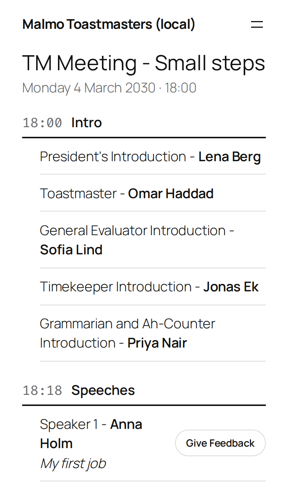
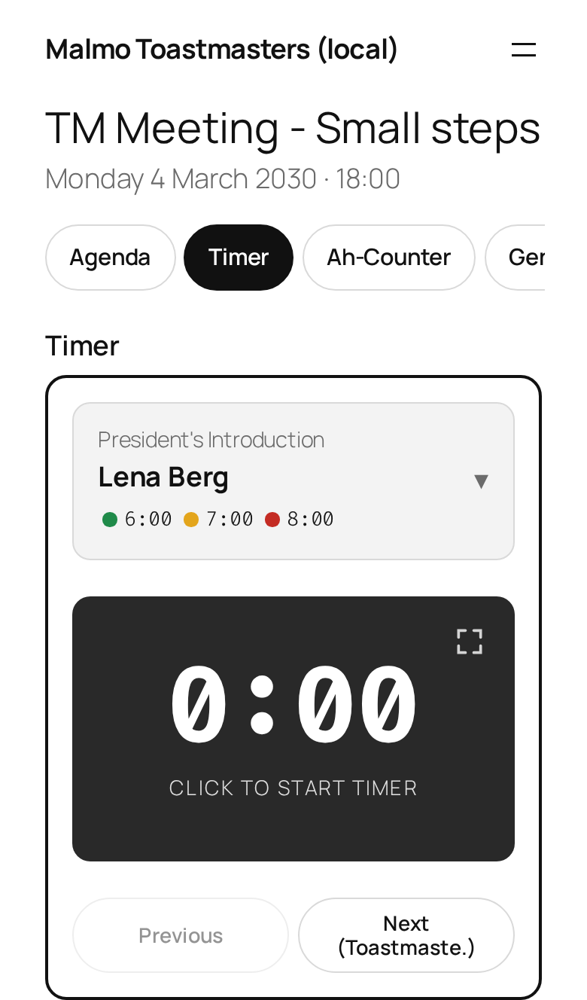
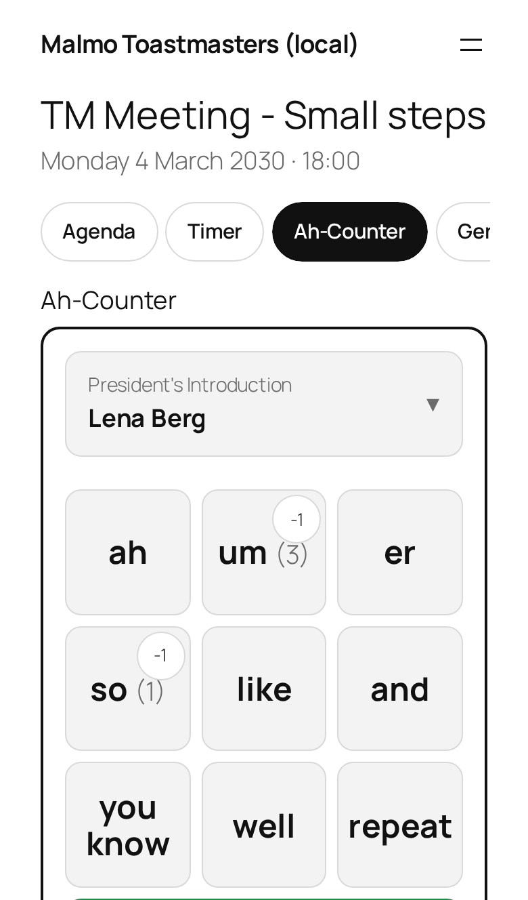
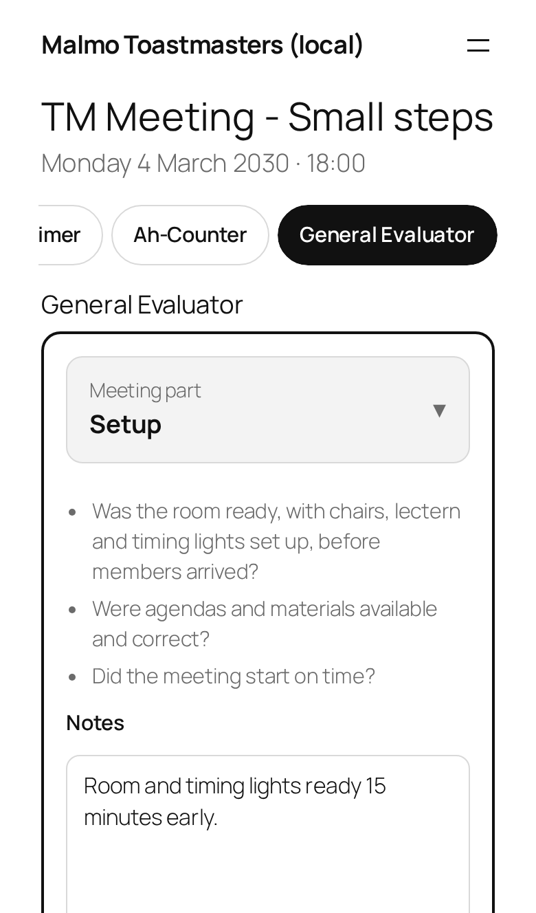
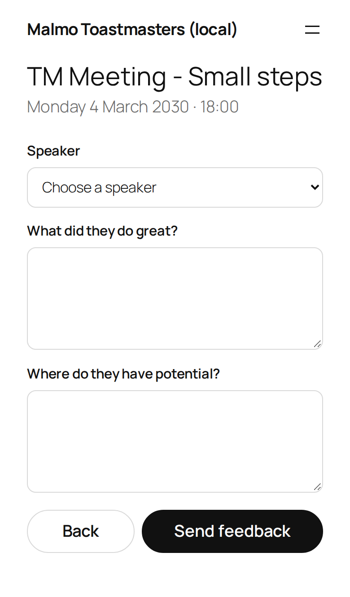
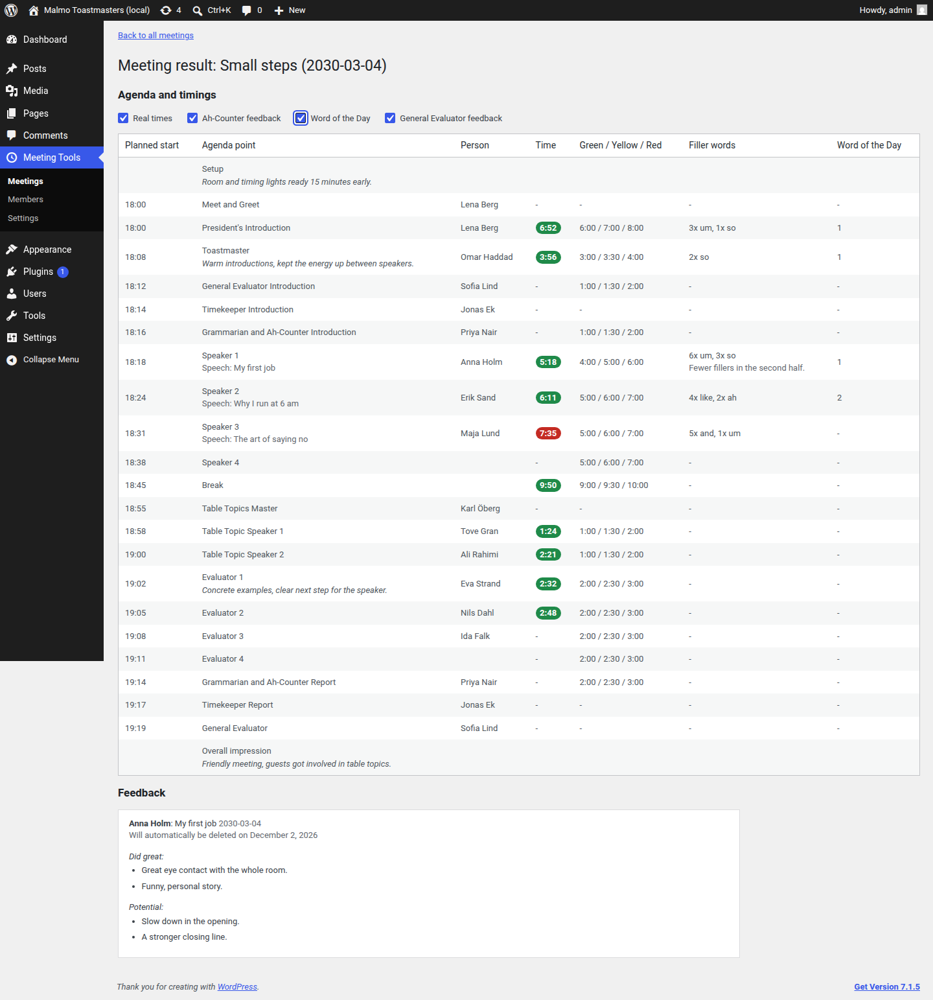
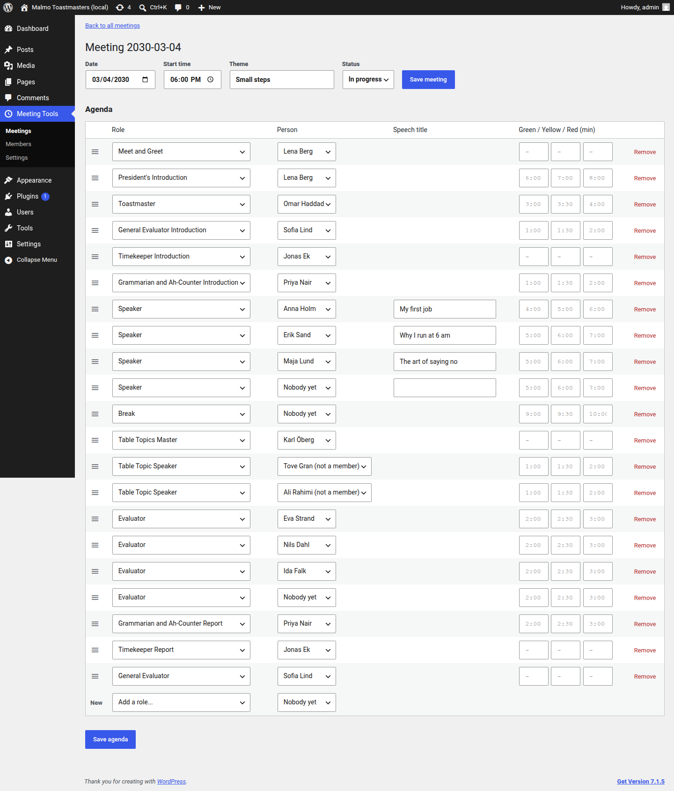
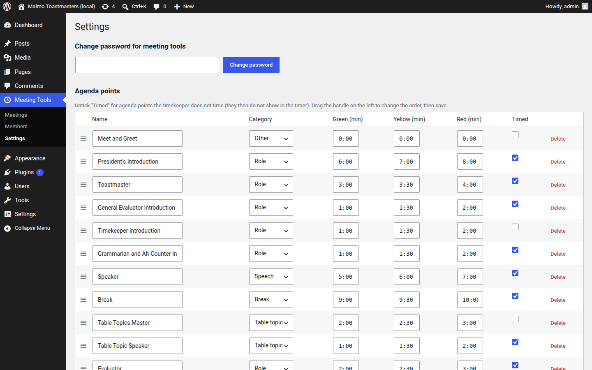
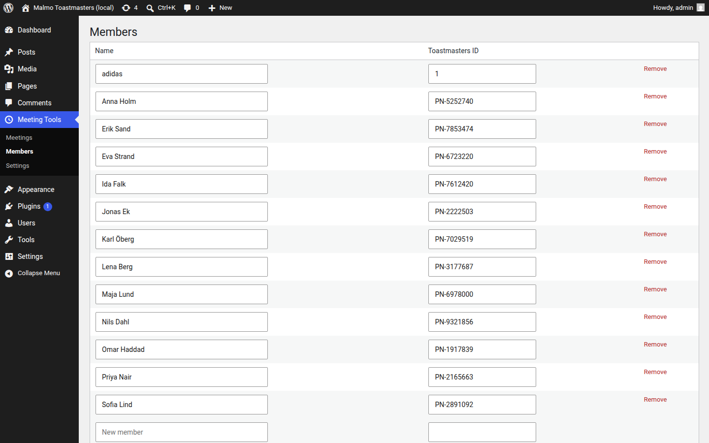

# TM Meeting Tools

A WordPress plugin that runs a Toastmasters club meeting from the phones in the room: the agenda, the timer, the Ah-Counter, the General Evaluator's notes and anonymous speech feedback from the audience. Afterwards, everything comes together on one results page per meeting.

It was built for [Malmö Toastmasters](https://malmo-tm.infinityfreeapp.com) but works for any club. It needs no app and no accounts for role holders: people open the meeting page and unlock the tools with one shared club password.

| Agenda | Timer | Ah-Counter | General Evaluator | Audience feedback |
| --- | --- | --- | --- | --- |
|  |  |  |  |  |

## Features

### On the meeting page (phones)

- **Agenda**: the meeting split into Meet and Greet, Introduction, Speeches, Break, Table Topics and Feedback, with the planned start time of each part. Each prepared speech has a "Give Feedback" button.
- **Timer** (timekeeper):
  - Steps through the timed agenda points, with Previous / Next buttons and a dropdown to jump.
  - Tap to start and stop, with a full-screen green / yellow / red signal and vibration on every colour change. The screen stays awake.
  - Each time is saved when you stop. The clock survives a locked phone or a reload.
  - During Table Topics, typing a new speaker's name adds them to the agenda straight away. Guests can be ticked as "Guest", so they are timed but not rated.
  - A live timing report below the timer, grouped by agenda section.
- **Ah-Counter**:
  - One large button per filler word (ah, um, er, so, like, and, you know, well, repeat) plus a button for the Word of the Day. Every tap saves on its own, and -1 fixes a mistake.
  - A notes box per speaker.
  - If the Word of the Day is not set yet, the Ah-Counter can set it.
  - A live report per person, showing the top two filler words and the Word of the Day count.
  - New table topic speakers from the timer appear within 5 seconds.
- **General Evaluator**:
  - Notes per meeting part, in agenda order: Setup, Meet and Greet, Opening, Toastmaster, Break, Table Topics Master, each evaluator, Ah-Counter, Grammarian, Timer, Closing and Overall impression.
  - Three guiding questions per part for inspiration.
  - Notes save while typing.
- **Audience feedback**: anonymous "What did they do great?" and "Where do they have potential?" for each prepared speech. No login needed. It is protected by a form nonce, a honeypot field and rate limiting.

The tools are mobile first and follow the site theme, including dark style variations.

### In wp-admin

| Meeting results | Agenda editor |
| --- | --- |
|  |  |

| Settings | Members |
| --- | --- |
|  |  |

- **Meetings**: every new meeting starts from the standard agenda.
  - Pick people from the member list.
  - Speakers get a speech title.
  - Times show the agenda point's default as a placeholder; type over them to change a time for one meeting.
  - Drag rows to reorder them. Click a meeting's date to open its results.
- **Meeting result**: one table along the agenda showing:
  - the planned start of each point;
  - the real time, as a badge coloured by result (green within, red more than 30 s under or over);
  - the timing window;
  - the Ah-Counter's filler words and notes;
  - the Word of the Day count;
  - the General Evaluator's notes.

  Each group of columns can be switched on and off. Below the table, audience feedback is merged into one card per speaker.
- **Members**: name and Toastmasters ID (the tmclub.eu user ID). The agenda editor's Person field is a dropdown of members. The club manager syncs members from tmclub.eu (easy-Speak) every time it sees them in a meeting; the list shows when each member was last synced.
- **Settings**:
  - Change the shared password for the meeting tools.
  - How many days members (not seen in a meeting) and feedback are kept before they are deleted.
  - Edit the agenda points: name, category, default green / yellow / red times, whether the timekeeper times them, and their order (drag to change it).

### Housekeeping

- **Meet and Greet** takes 15 minutes and is the first point on the agenda: the meeting start (from tmclub.eu) is when Meet and Greet begins.

- A meeting is marked **Completed** automatically 30 minutes after its planned end (start time plus all agenda times).
- **Audience and evaluator feedback is deleted 7 days after it was given** (days set in *Settings*): it is for the speaker to read after the meeting, not to keep. The feedback card shows the date.
- **Members not seen in a meeting for 60 days are deleted** (days set in *Settings*, checked once a day). Adding a member by hand counts as seeing them.

## Install

Needs WordPress 6.9 or newer (it uses the Abilities API) and PHP 7.4 or newer.

1. Zip the plugin folder itself (not its contents): `zip -r tm-meeting-tools.zip tm-meeting-tools`.
2. In wp-admin go to *Plugins > Add New > Upload Plugin*, choose the zip, then install and activate it. On hosts without uploads, copy the folder to `wp-content/plugins/` and activate it there.
3. In *Meeting Tools > Settings*, set the **password for the meeting tools** and check the agenda point times.
4. In *Meeting Tools > Members*, add the club members.
5. In *Meeting Tools > Meetings*, create the next meeting and fill in the people.
6. Add the blocks below to pages.

To update, upload the new zip the same way ("Replace current with uploaded"). Database changes run automatically. Deleting the plugin in wp-admin removes its tables and options.

## Blocks and shortcodes

| Block | Shortcode | Shows |
| --- | --- | --- |
| Meeting agenda and tools | `[tm_meeting]` or `[tm_meeting id="12"]` | The agenda plus tabs for the Timer, Ah-Counter and General Evaluator (after unlocking). |
| Speech feedback form | `[tm_feedback_form]` | Only the anonymous audience form, which works well behind a QR code. |
| – | `[tm_next_meeting]`, `[tm_next_meeting format="H:i" empty="soon"]` | The next meeting's date (default format `l j F`, e.g. "Monday 7 December") as plain text, for sentences such as a thank-you page. `empty` is shown when no meeting is planned. |
| Meeting results (private) | `[tm_meeting_report]` | The results with meeting and person filters. It only renders for admins, or on a page protected with a WordPress page password. |

Without an ID, the blocks show the next meeting, or the latest one if none is coming up. `?tm_meeting=ID` picks another meeting. You can link straight to a tab: `/meeting/#timer`, `#ah-counter`, `#feedback` (General Evaluator) or `#audience`.

## How it works

- **Role holders are not WordPress users.** One shared password sets a cookie for 14 days. Changing the password signs out every phone. Wrong attempts are rate limited.
- **Every action is a WordPress ability** (`tm-meeting-tools/<name>`, all `show_in_rest`). The front-end tools call the same abilities through `/wp-json/wp-abilities/v1/abilities/<name>/run`, so permissions are decided in one place. Reads use GET (`?input[key]=value`), deletes use DELETE, and everything else uses POST with `{"input": {...}}`.
- **Data** lives in custom tables (prefix `wp_tmmt_`): `role_types` (agenda points), `members`, `meetings`, `agenda_items`, `timings`, `filler_counts`, `feedback`. Removing an agenda item keeps its results under the person's name. Deleting a meeting deletes its results.

### Abilities

Permission: *public* means anyone; *tools* means the tools cookie or an admin; *admin* means `manage_options` (change it with the `tmmt_manage_capability` filter).

| Ability | Permission | What it does |
| --- | --- | --- |
| `list-meetings`, `get-meeting` | public | Meetings and a full agenda with resolved timing. `get-meeting` without an ID returns the current meeting. |
| `create-meeting`, `delete-meeting` | admin | Create (optionally from the standard agenda) or delete a meeting with all its results. |
| `update-meeting` | admin; tools for the Word of the Day only | Change date, time, theme, Word of the Day or status. |
| `add-agenda-item` | admin; tools for table topic speakers | Add an agenda item, at the end or after a given item. |
| `update-agenda-item` | admin; tools to mark table topic guests or rename speakers added on the day | Change role, person, speech title, timing or the guest flag. |
| `remove-agenda-item`, `reorder-agenda-items` | admin | Remove or reorder agenda items. |
| `list-role-types` | public | Agenda points, categories, speech categories and filler words. |
| `create-role-type`, `update-role-type`, `delete-role-type` | admin | Manage agenda points. |
| `get-tools-status`, `unlock-tools`, `lock-tools` | public | Tools password and cookie. |
| `record-timing`, `clear-timing`, `get-timing-report`, `complete-meeting` | tools | Timer results. Recording again replaces the earlier time. |
| `save-filler-counts`, `list-filler-counts`, `delete-filler-counts` | tools | Ah-Counter counts and notes, one record per agenda item. |
| `save-general-evaluation`, `list-general-evaluation` | tools | The General Evaluator's notes per meeting part. |
| `submit-feedback` | public with the form nonce (audience); tools (evaluation) | Typed feedback. |
| `list-feedback`, `delete-feedback`, `get-results` | admin | All feedback and results for a meeting and/or person. |
| `list-members` | admin | Members with Toastmasters ID (tmclub.eu user ID) and when they were last synced. |
| `sync-members` | admin | Add or update members from tmclub.eu (`{"members": [{"tm_id", "name"}]}`) and mark them as synced now. Matches by Toastmasters ID, then by name among members without one. |

Example with WP-CLI:

```bash
wp eval 'print_r( wp_get_ability( "tm-meeting-tools/get-meeting" )->execute( array() ) );'
```

Example over REST, using an application password over HTTPS:

```bash
curl -u admin:APP_PASSWORD -H 'Content-Type: application/json' \
  -d '{"input":{"date":"2026-12-07","theme":"Winter","template":"standard"}}' \
  https://example.org/wp-json/wp-abilities/v1/abilities/tm-meeting-tools/create-meeting/run
```

### Filters

- `tmmt_manage_capability`: who counts as an admin (default `manage_options`).
- `tmmt_filler_words`: the Ah-Counter buttons.
- `tmmt_speech_categories`: speech types and their times.
- `tmmt_feedback_rate_limit`: audience submissions allowed per 5 minutes per IP (default 40, generous because the room shares one Wi-Fi).

## Development

The repo holds the plugin (`tm-meeting-tools/`), a Docker setup and the tests.

```bash
docker compose up -d     # WordPress 7.0 + MariaDB on http://localhost:8087 (WP_DEBUG on)
docker compose run --rm cli wp core install --url=http://localhost:8087 --title="TM local" \
  --admin_user=admin --admin_password=admin --admin_email=admin@example.com --skip-email
docker compose run --rm cli wp rewrite structure '/%postname%/'
docker compose run --rm cli wp plugin activate tm-meeting-tools
```

The plugin folder is mounted into the container, so edits show up on reload. If WordPress cannot read the plugin, run `chmod -R o+rX tm-meeting-tools`.

### Tests

```bash
# Demo data: a meeting with people, the pages /meeting/ /feedback/ /results/
# (page password board2026) and the tools password club2026. Deletes all existing meetings.
docker compose run --rm -v $PWD/tests:/tests:ro cli wp eval-file /tests/seed.php

# Abilities, run inside WordPress
docker compose run --rm -v $PWD/tests:/tests:ro cli wp eval-file /tests/abilities-smoke.php

# Browser end to end at phone width (needs Playwright: PLAYWRIGHT=/path/to/playwright/index.mjs)
node tests/e2e.mjs http://localhost:8087 ./screenshots
node tests/rest-and-editor.mjs http://localhost:8087 ./screenshots
node tests/dark.mjs http://localhost:8087 ./screenshots dark
```

If you lock yourself out of the tools while testing: `docker compose run --rm cli wp transient delete --all`.

## License

GPL-2.0-or-later, like WordPress itself. See [LICENSE](LICENSE) for the GNU General Public License version 2.
